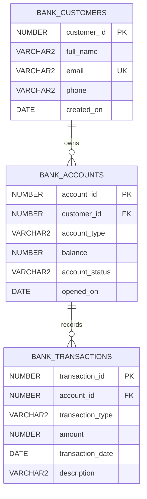

# Banking Management System using Oracle PL/SQL

A GitHub-ready case study for a small, educational banking database. The project models customers, accounts, and a transaction ledger, then uses PL/SQL procedures and triggers to enforce basic banking rules.

> **Scope:** classroom demonstration only. This project is not suitable for real banking or production use.

## Case study

A banking database must keep account balances consistent with transaction history and reject invalid operations. If deposits, withdrawals, and transfers are performed with unrelated manual SQL statements, an incorrect amount or a partially completed transfer can leave the records inconsistent.

This project places the core rules in an Oracle schema and PL/SQL program units. The caller submits an operation through a procedure; a validation trigger checks it before the ledger row is stored; a second trigger updates the account's current balance. A transfer writes one outgoing and one incoming ledger row under a savepoint, so a failure during either side rolls back the procedure's partial work.

## Goals

- Store customers, their accounts, and account activity in related tables.
- Use constraints to protect identifiers, relationships, account types, statuses, and positive transaction amounts.
- Provide procedures to open an account, deposit, withdraw, and transfer funds.
- Provide a function to retrieve an account balance.
- Demonstrate trigger-based validation, exception handling, row locking, savepoints, and caller-controlled commits.

## Data model



A customer can have multiple accounts. Each account belongs to one customer and can have multiple ledger entries. The account's `balance` is a current summary; `BANK_TRANSACTIONS` stores the activity history.

## Main components

| Component | Responsibility |
| --- | --- |
| `sp_open_account` | Validates the customer and account type, then opens a zero-balance account. |
| `sp_deposit` | Inserts a `DEPOSIT` ledger entry. |
| `sp_withdraw` | Inserts a `WITHDRAWAL` entry; the validation trigger checks available funds. |
| `sp_transfer` | Locks both accounts in numeric order, then inserts `TRANSFER_OUT` and `TRANSFER_IN` entries. |
| `fn_get_balance` | Returns the current balance or raises an application error for an unknown account. |
| `trg_transaction_validate` | Rejects invalid amounts, missing or inactive accounts, and overdrafts. |
| `trg_transaction_apply_balance` | Adjusts the account balance after a valid ledger entry is inserted. |

## Business rules and transaction handling

- Account types are `SAVINGS` or `CURRENT`; statuses are `ACTIVE` or `INACTIVE`.
- Amounts must be greater than zero. An account balance cannot be negative.
- Deposits and incoming transfers increase the balance. Withdrawals and outgoing transfers decrease it.
- Withdrawals and transfers out require sufficient funds. Both transfer accounts must be active and different.
- Every transfer creates two ledger rows. The procedure uses a savepoint and rolls back its own partial work if either insert fails.
- Procedures do not commit automatically. The calling script or application decides to `COMMIT` or `ROLLBACK` the overall work.

## Demonstration result

The included script seeds two fictional customers and accounts, then runs this sequence:

| Step | Operation | Account 5001 | Account 5002 |
| --- | --- | ---: | ---: |
| Start | Opening balances | 0.00 | 0.00 |
| 1 | Deposit 5,000.00 into 5001 | 5,000.00 | 0.00 |
| 2 | Withdraw 1,200.00 from 5001 | 3,800.00 | 0.00 |
| 3 | Transfer 700.00 from 5001 to 5002 | 3,100.00 | 700.00 |
| 4 | Attempt to withdraw 10,000.00 from 5002 | Rejected; balances stay unchanged | Rejected; balances stay unchanged |

The final successful transaction history contains four rows: one deposit, one withdrawal, a transfer out, and its matching transfer in. The insufficient-funds attempt is expected to raise `ORA-20002` and is rolled back.

The values above are the **expected output described by the supplied project materials**. The accompanying output appendix is illustrative SQL Developer-style output, not a screenshot or record of a live Oracle session. Run the script in Oracle to see the actual output for your environment.

## Repository contents

```text
Banking_Management_System_PL-SQL_GitHub/
├── README.md
├── banking_management_system.sql
└── sample_output.md
```

## Requirements

- An Oracle Database schema/user.
- Oracle SQL Developer, SQLcl, or another Oracle client that supports SQL*Plus-style script execution and PL/SQL blocks.
- Permission to create tables, sequences, indexes, procedures, functions, and triggers.

No external libraries are required.

## Run the project

1. Connect the Oracle client to a **new, empty schema**.
2. Open `banking_management_system.sql`.
3. In SQL Developer, run it with **F5 (Run Script)** so the `/` lines compile the PL/SQL units and the script output is displayed.
4. Review the account and transaction queries printed at the end.

The setup script is intended to run once in a clean schema. It does not drop existing objects, so it will report name conflicts if you run it again in the same schema. The sample identifiers `1001`, `1002`, `5001`, `5002`, and `9001` onward assume the supplied sequence start values and a first run.

To query a balance after the demonstration:

```sql
SELECT fn_get_balance(5001) AS balance FROM dual;
```

Expected result: `3100`.

## Limitations and next steps

This is a single-currency learning model. It does not include authentication, authorization roles, encryption, regulatory reporting, interest, fees, reversals, or concurrent-load testing. It also has no schema migration or reset script. Possible extensions include an account statement report, audit fields, role-based access, controlled reversal entries, a simple user interface, and concurrency tests.

## Data note

The data is fictional. Phone values in the public-ready SQL file are set to `NULL`; the sample email addresses use the reserved `example.com` domain. The source report PDFs are not included in this bundle because they contain student and course-identifying details.
